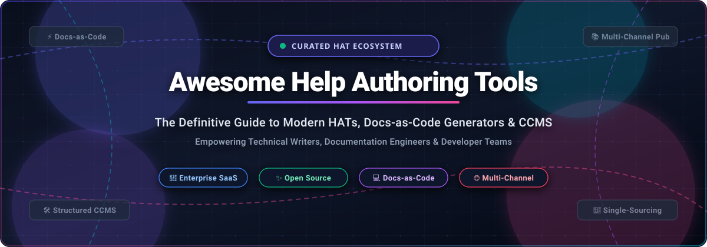
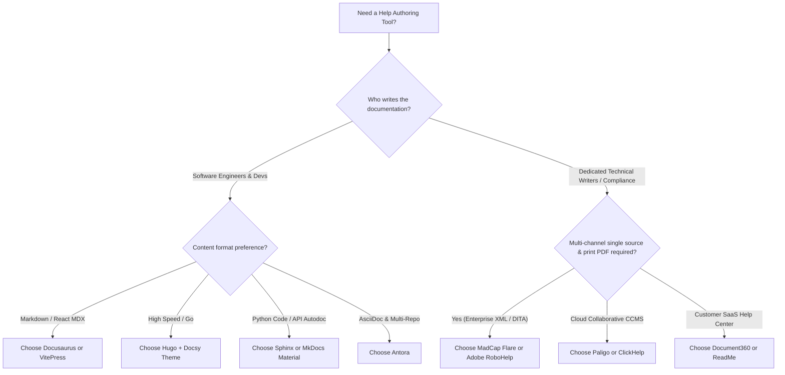

# 📖 Awesome Help Authoring Tools (HAT) & Docs Ecosystem 🛠️

**A curated index of top SaaS platforms, Component Content Management Systems (CCMS), and open-source docs-as-code static site generators.**

  
  
  
  
  
  
  

---

## 📌 Executive Summary & Scope

A **Help Authoring Tool (HAT)** is a specialized software application used by technical communicators, documentation engineers, and developer advocates to create, manage, and publish structured help materials, knowledge bases, software manuals, user guides, and API documentation.

Modern technical authoring spans three distinct paradigms:
1. 🏢 **Enterprise SaaS & CCMS Suites:** XML/DITA-based topic authoring, single-sourcing, localization, and multi-channel publishing (HTML5, PDF, ePUB).
2. 💻 **Docs-as-Code Static Site Generators:** Markdown/AsciiDoc/reStructuredText source files stored in Git repositories, verified via CI/CD, and deployed as lightning-fast static web applications.
3. 🤝 **Collaborative Team Wikis:** Real-time WYSIWYG and Markdown knowledge bases built for internal engineering and cross-functional company handbooks.

---

## 📑 Table of Contents

- [📊 Sector Overview & Market Dynamics](#-sector-overview--market-dynamics)
- [🏢 SaaS & Enterprise Help Authoring Platforms](#-saas--enterprise-help-authoring-platforms)
- [✨ Open-Source GitHub Projects](#-open-source-github-projects)
- [⚖️ Architectural Comparison: SaaS CCMS vs Docs-as-Code](#-architectural-comparison-saas-ccms-vs-docs-as-code)
- [🔍 Technical Evaluation & Buyer Guide](#-technical-evaluation--buyer-guide)
- [🤝 How to Contribute](#-how-to-contribute)
- [🛡️ Disclaimer](#-disclaimer)
- [⭐ Star History](#-star-history)
- [💖 Support & Community](#-support--community)

---

## 📊 Sector Overview & Market Dynamics

The global **Technical Documentation and Help Authoring Tool (HAT)** market is estimated at approximately **$1.8 billion to $2.2 billion** for specialized technical authoring suites and CCMS software, expanding to over **$6.0 billion** when encompassing the broader IT and developer documentation software ecosystem, with an estimated compound annual growth rate (CAGR) of **8.4% to 9.6% through 2030**.

The sector exhibits **moderate to high fragmentation** rather than a winner-take-all monopoly:
- **Legacy & Regulatory Workflows:** Long-established enterprises in aerospace, medical devices, defense, and heavy software remain anchored in proprietary XML/DITA authoring ecosystems (such as Adobe RoboHelp and MadCap Flare) due to rigorous compliance, single-source print PDF generation, and multi-lingual translation requirements.
- **Developer-Led Disruptions:** Software-first organizations have decisively migrated toward **docs-as-code** static frameworks (such as Docusaurus, Hugo, VitePress, and MkDocs) and cloud-native collaborative hubs (such as ReadMe and GitBook), decoupling authoring from expensive per-seat licenses.
- **AI-Powered Acceleration:** Modern authoring tools are rapidly embedding AI indexing (`llms.txt`, MCP servers, and semantic search), transforming traditional documentation from static reference pages into machine-readable knowledge layers.

---

## 🏢 SaaS & Enterprise Help Authoring Platforms

The following table provides verified starting tier prices, explicit free tier / free trial limits, and corporate scale metrics. The entries are sorted in descending order by **Company Scale (Valuation / Market Capitalization / Annual Revenue)**.

| 🏢 Product / Vendor | 📈 Company Scale (Valuation / Revenue) | 💰 Starting Tier Pricing | 🎁 Free Tier / Free Trial Limits | 🎯 Primary Use Case & Key Features |
| :--- | :--- | :--- | :--- | :--- |
| **[Adobe RoboHelp](https://www.adobe.com/products/robohelp.html)** | **$220B+ Market Cap** (NASDAQ: ADBE) • **$21.4B Annual Revenue** | **$29.99 / user / month** *(Billed annually with 1-year contract; ~$359.88/yr)* | **30-day fully functional free trial**. • No credit card required upfront. • Full access to HTML5, PDF, EPUB, and microcontent tools. No perpetual free plan. | Enterprise technical authoring, responsive HTML5 help systems, print manuals, and Adobe Technical Communication Suite integration. |
| **[Atlassian Confluence](https://www.atlassian.com/software/confluence)** | **$48B+ Market Cap** (NASDAQ: TEAM) • **$4.4B Annual Revenue** | **$6.05 / user / month** *(Standard Tier, billed monthly or annually)* | **Free-forever plan up to 10 users**. • Includes 2 GB file storage, unlimited pages, spaces, and whiteboards. • Paid tiers include 7-day trial. | Team knowledge base, internal engineering wikis, product requirement documentation, and Jira agile toolchain integration. |
| **[Paligo](https://paligo.net/)** | **~$150M Valuation** • **$12.5M ARR** *(Backed by Gro Capital & Alfvén; $29M raised)* | **$4,800 / year** *(~$400/mo billed annually for Professional tier, 1 author seat)* | **30-day proof-of-concept trial**. • Granted via assisted sales demonstration. • Full access to cloud CCMS authoring, topic reuse, and multi-channel publishing. No self-serve free tier. | Cloud Component Content Management System (CCMS), structured XML/topic authoring, single-sourcing, and translation workflows. |
| **[MadCap Flare](https://www.madcapsoftware.com/products/flare/)** | **~$100M+ Private Valuation** • **$18M–$20M ARR** *(Majority investment by Battery Ventures)* | **$3,150 / author / year** *(~$262.50/mo billed annually for base authoring license)* | **30-day full-featured free trial**. • No credit card required. • Access to desktop & online authoring, project templates, and introductory web training. No permanent free tier. | Enterprise single-source publishing, conditional text filtering, complex regulatory PDF/HTML output, and translation memory management. |
| **[Document360](https://document360.com/)** | **~$80M–$100M Est. Valuation** • **$20M+ Kovai.co Revenue** *(Bootstrapped; $10M+ Document360 ARR)* | **$149 / project / month** *(Billed annually for Professional tier; 3 team accounts)* | **14-day full-featured free trial**. • Full access to Eddy AI, analytics, custom domain, and portal customization. • Freemium tier historically limited to 2 team members & 1 project. | Customer-facing knowledge bases, SaaS help centers, product documentation, and self-service support portals. |
| **[ReadMe](https://readme.com/)** | **~$70M Valuation** • **$10M ARR** *(Backed by Accel & Y Combinator)* | **$99 / project / month** *(Startup tier billed annually; 3 admin users)* | **Free-forever developer tier**. • 1 API version, 3 project members, basic API reference explorer, and Markdown guides. • 14-day free trial on Business/Enterprise. | Interactive developer hubs, OpenAPI/Swagger automated doc generation, interactive API explorers, and API log telemetry. |
| **[GitBook](https://www.gitbook.com/)** | **~$40M Valuation** • **$3.5M ARR** *(Backed by Point Nine & Eight Roads)* | **$65 / site / month** *(Billed annually; Premium tier) + $12/user/mo* | **Free-forever plan for 1 user**. • Unlimited public documentation sites on `*.gitbook.io`, GitHub sync, and 10 GitBook AI messages/week. • 30-day trial for team plans. | Developer and product documentation with automated AI knowledge layers (auto-generated `llms.txt`, MCP servers, and Git synchronization). |
| **[ClickHelp](https://clickhelp.com/)** | **~$12M–$15M Est. Valuation** • **$2.9M ARR** *(Bootstrapped, 15+ years profitable)* | **$185 / month** *(Billed annually; Starter plan for 2 authors, 500 topics)* | **30-day unrestricted free trial**. • Includes 10 GB storage, unlimited reviewer roles, full topic import, and multi-format publishing. • Dedicated free sandbox for evaluation. | Cloud-based help authoring, multi-format web/PDF export, migration from legacy CHM/RoboHelp, and role-based review workflows. |

---

## ✨ Open-Source GitHub Projects

The open-source ecosystem provides transparent, cost-effective, docs-as-code alternatives to expensive proprietary licenses. Below are the leading open-source repositories, sorted in descending order by **GitHub Stars_Count**.

### 1. 🚀 [Hugo](https://gohugo.io/) 
- **Repository:** [`gohugoio/hugo`](https://github.com/gohugoio/hugo) | **License:** Apache-2.0
- **Tech Stack:** Go (Golang)
- **Overview:** The world's fastest static site engine. Renders thousands of pages in fractions of a second. Extensively utilized for massive documentation systems with battle-tested documentation themes such as *Docsy*, *Hugo Book*, and *Geekdoc*.
- **Strengths:** Unrivaled compilation speed, zero runtime dependencies, robust asset pipelines, and flexible taxonomies.

---

### 2. ⚛️ [Docusaurus](https://docusaurus.io/) 
- **Repository:** [`facebook/docusaurus`](https://github.com/facebook/docusaurus) | **License:** MIT
- **Tech Stack:** React, Node.js, MDX
- **Overview:** Meta's flagship documentation framework. Combines Markdown with interactive React components via MDX. Generates a blazing-fast Single Page Application (SPA) with client-side navigation.
- **Strengths:** Built-in multi-versioning, first-class internationalization (i18n), pre-configured Algolia DocSearch, and extensive customization through React components.

---

### 3. 📝 [Outline](https://www.getoutline.com/) 
- **Repository:** [`outline/outline`](https://github.com/outline/outline) | **License:** BSL 1.1 (Business Source License / Free self-hosted)
- **Tech Stack:** TypeScript, React, Node.js, PostgreSQL
- **Overview:** A lightning-fast, collaborative team wiki and knowledge base designed as an open-source, self-hostable alternative to Notion.
- **Strengths:** Real-time multi-user editing, clean distraction-free typography, Markdown support, nested collections, and enterprise OAuth/OIDC authentication.

---

### 4. 📜 [Slate](https://github.com/slatedocs/slate) 
- **Repository:** [`slatedocs/slate`](https://github.com/slatedocs/slate) | **License:** Apache-2.0
- **Tech Stack:** Ruby, Middleman, JavaScript
- **Overview:** The pioneer of modern three-column API documentation inspired by Stripe. Places navigation on the left, descriptive markdown in the middle, and multi-language code samples on the right.
- **Strengths:** Clean single-page layout, smooth scrolling, out-of-the-box multi-language code switching, and zero server-side database requirements.

---

### 5. ⚡ [Docsify](https://docsify.js.org/) 
- **Repository:** [`docsifyjs/docsify`](https://github.com/docsifyjs/docsify) | **License:** MIT
- **Tech Stack:** JavaScript, Vue.js
- **Overview:** A magical documentation generator that dynamically renders Markdown files directly in the browser without an ahead-of-time build step.
- **Strengths:** No static site compilation step required, ultra-lightweight footprint, instant setup, rich plugin ecosystem (full-text search, emoji, copy-code).

---

### 6. 🌐 [Wiki.js](https://js.wiki/) 
- **Repository:** [`requarks/wiki`](https://github.com/requarks/wiki) | **License:** AGPL-3.0
- **Tech Stack:** Node.js, Vue.js, PostgreSQL/MySQL/SQLite
- **Overview:** A modern, extensible open-source wiki software featuring two-way Git synchronization, multiple editor formats (Markdown, Visual WYSIWYG, Raw HTML, AsciiDoc), and robust authentication.
- **Strengths:** Bi-directional Git sync, granular role-based access control (RBAC), multi-engine search (Elasticsearch, PostgreSQL, Lunr), and localized content translation.

---

### 7. 🎨 [Material for MkDocs](https://squidfunk.github.io/mkdocs-material/) 
- **Repository:** [`squidfunk/mkdocs-material`](https://github.com/squidfunk/mkdocs-material) | **License:** MIT
- **Tech Stack:** Python, MkDocs, HTML5/SCSS, TypeScript
- **Overview:** The definitive technical documentation theme built on top of MkDocs. Implements Google's Material Design with advanced technical documentation primitives.
- **Strengths:** Instant client-side search, code block annotations and tabs, admonitions, automatic dark/light theme switching, and social card generation.

---

### 8. 📑 [Redoc](https://redocly.com/redoc/) 
- **Repository:** [`Redocly/redoc`](https://github.com/Redocly/redoc) | **License:** MIT
- **Tech Stack:** TypeScript, React
- **Overview:** OpenAPI / Swagger-powered API reference generator delivering responsive, enterprise-grade three-panel API documentation.
- **Strengths:** Native OpenAPI 3.0 & 3.1 support, deep schema nesting, interactive request/response payloads, and turnkey Docker/NPM deployment.

---

### 9. 🐍 [MkDocs](https://www.mkdocs.org/) 
- **Repository:** [`mkdocs/mkdocs`](https://github.com/mkdocs/mkdocs) | **License:** BSD-2-Clause
- **Tech Stack:** Python
- **Overview:** Fast, simple static site generator built specifically for project documentation. Configured via a single `mkdocs.yml` file and written in standard Markdown.
- **Strengths:** Built-in development server with live-reloading, zero configuration overhead, clean CLI, and automated GitHub Pages deployment via `mkdocs gh-deploy`.

---

### 10. 🦀 [mdBook](https://rust-lang.github.io/mdBook/) 
- **Repository:** [`rust-lang/mdBook`](https://github.com/rust-lang/mdBook) | **License:** MPL-2.0
- **Tech Stack:** Rust
- **Overview:** Command-line tool written in Rust to create online books and documentation manuals from Markdown files. Famous for powering the official Rust programming books.
- **Strengths:** Blazing fast native Rust binary, integrated search, printable single-page output, code playground integration, and custom preprocessors.

---

### 11. 🏢 [Docmost](https://docmost.com/) 
- **Repository:** [`docmost/docmost`](https://github.com/docmost/docmost) | **License:** AGPL-3.0
- **Tech Stack:** TypeScript, NestJS, React, PostgreSQL, Redis
- **Overview:** A collaborative documentation and wiki software designed as a clean, open-source alternative to Confluence and Notion.
- **Strengths:** Real-time block editing, diagram embedding (Draw.io, Excalidraw, Mermaid), workspaces, spaces, and granular permission controls.

---

### 12. 📚 [BookStack](https://www.bookstackapp.com/) 
- **Repository:** [`BookStackApp/BookStack`](https://github.com/BookStackApp/BookStack) | **License:** MIT
- **Tech Stack:** PHP, Laravel, MySQL
- **Overview:** An opinionated, simple self-hosted documentation platform built on an intuitive real-world library metaphor: **Shelves → Books → Chapters → Pages**.
- **Strengths:** Simple user onboarding for non-technical authors, built-in diagram editor (Draw.io), audit logging, and export to PDF, HTML, and Markdown.

---

### 13. ⚡ [VitePress](https://vitepress.dev/) 
- **Repository:** [`vuejs/vitepress`](https://github.com/vuejs/vitepress) | **License:** MIT
- **Tech Stack:** Vue 3, Vite
- **Overview:** Vite-powered static site generator, designed as the modern successor to VuePress. Engineered to deliver exceptional developer experience and ultra-fast build speeds.
- **Strengths:** Instant dev server startup with Vite HMR, Vue component support inside Markdown, minimal bundle sizes, and built-in local search.

---

### 14. 🌟 [Starlight (Astro)](https://starlight.astro.build/) 
- **Repository:** [`withastro/starlight`](https://github.com/withastro/starlight) | **License:** MIT
- **Tech Stack:** Astro, TypeScript
- **Overview:** Astro’s official documentation framework designed to deliver performant documentation websites with zero client-side JavaScript by default.
- **Strengths:** Flawless Lighthouse performance scores, built-in Pagefind static search, comprehensive i18n routing, and Markdown/MDX component integration.

---

### 15. 📖 [Read the Docs](https://about.readthedocs.com/) 
- **Repository:** [`readthedocs/readthedocs.org`](https://github.com/readthedocs/readthedocs.org) | **License:** MIT
- **Tech Stack:** Python, Django
- **Overview:** The foundational open-source continuous documentation hosting platform. Automatically builds and hosts Sphinx and MkDocs documentation directly from Git repositories.
- **Strengths:** Native support for multiple simultaneous software versions (e.g., `v1.0`, `v2.0`, `latest`), automated PDF and EPUB generation, and custom domain hosting.

---

### 16. 🐍 [Sphinx](https://www.sphinx-doc.org/) 
- **Repository:** [`sphinx-doc/sphinx`](https://github.com/sphinx-doc/sphinx) | **License:** BSD-2-Clause
- **Tech Stack:** Python, reStructuredText / MyST Markdown
- **Overview:** The venerable technical documentation engine powering the official Python documentation, Linux Kernel docs, and major scientific and aerospace libraries.
- **Strengths:** Unrivaled code introspection via `autodoc`, single-source generation into HTML, LaTeX PDF, EPUB, and Unix man pages, and cross-reference indexing across disparate repositories via `intersphinx`.

---

### 17. 🐜 [Antora](https://antora.org/)
- **Repository / Mirror:** [`antora/antora`](https://gitlab.com/antora/antora) (GitLab primary) | [`asciidoctor/docs.asciidoctor.org`](https://github.com/asciidoctor/docs.asciidoctor.org) | **License:** MPL-2.0
- **Tech Stack:** Node.js, AsciiDoc
- **Overview:** The multi-repository docs-as-code generator purpose-built for enterprise technical writers and distributed software architectures.
- **Strengths:** Built natively around AsciiDoc, aggregates documentation distributed across dozens of Git repositories and branches into a single unified versioned documentation portal.

---

## ⚖️ Architectural Comparison: SaaS CCMS vs Docs-as-Code

| Evaluation Factor | 🏢 Enterprise SaaS & CCMS (Flare, RoboHelp, Paligo) | 💻 Docs-as-Code (Docusaurus, Hugo, Sphinx, MkDocs) |
| :--- | :--- | :--- |
| **Authoring Interface** | Rich WYSIWYG, XML structural editors, proprietary forms | Plaintext Markdown, AsciiDoc, reStructuredText in code editors (VS Code) |
| **Licensing Cost** | High ($3,000–$15,000+ per author seat per year) | Free and open-source (zero per-seat licensing fees) |
| **Version Control** | Internal database versioning or custom CMS branching | Standard Git (branches, pull requests, code reviews, diffs) |
| **CI/CD Integration** | Proprietary build servers, manual export jobs | Native GitHub Actions, GitLab CI, and automated deployment pipelines |
| **Output Formats** | High-end print PDF (CMYK, bleed), Responsive HTML5, EPUB | Static Web SPA, HTML, Markdown, LaTeX PDF (via Sphinx/Pandoc) |
| **Target User Base** | Dedicated technical writers, compliance documentation teams | Software engineers, developer advocates, open-source maintainers |

---

## 🔍 Technical Evaluation & Buyer Guide

When selecting between a dedicated SaaS Help Authoring Tool and an open-source docs-as-code pipeline, consider the following technical decision criteria:

---

## 🤝 How to Contribute

Contributions to expand and update this curated Help Authoring Tool ecosystem are warmly welcomed!

1. 🍴 **Fork the Repository** on GitHub.
2. 🌿 **Create a New Branch:** `git checkout -b feature/add-new-tool`.
3. 📝 **Add or Update Entries:** Ensure tools are categorized correctly with verified pricing, free tier terms, and GitHub Stars_Counts.
4. ✅ **Ensure Factual Accuracy:** Include references, transparent descriptions, and avoid promotional language.
5. 🚀 **Submit a Pull Request** with a descriptive summary of your additions.

---

## 🛡️ Disclaimer

- This repository is a community-curated directory compiled for educational, architectural, and comparative evaluation purposes.
- All product names, trademarks, logos, and brands mentioned are the property of their respective trademark holders.
- Pricing metrics, plan tiers, and corporate valuations are subject to market fluctuations. Always verify latest terms on vendor official portals.

---

## ⭐ Star History

---

## 💖 Support & Community

Thank you for visiting and supporting the **Awesome Help Authoring Tool (HAT)** ecosystem! 🙏

If you found this repository helpful:
- ⭐ **Star this repository** to help others discover modern technical documentation tools!
- 🍴 **Fork and share** with technical writers, documentation engineers, and developer teams.
- ☕ **Support continuous maintenance:** You can sponsor and buy a coffee at the [GitHub Sponsor Dashboard](https://github.com/sponsors/ishandutta2007).

  

